<div align="center">

# FORM

**A fitness tracker that maps every rep, every set, every session.**

*Log the workout. See the progress. Beat yourself — by one.*

[](https://flutter.dev)
[](https://dart.dev)
[](LICENSE)
[](#getting-started)

</div>

---

## Screens

<table>
<tr>
<td width="33%">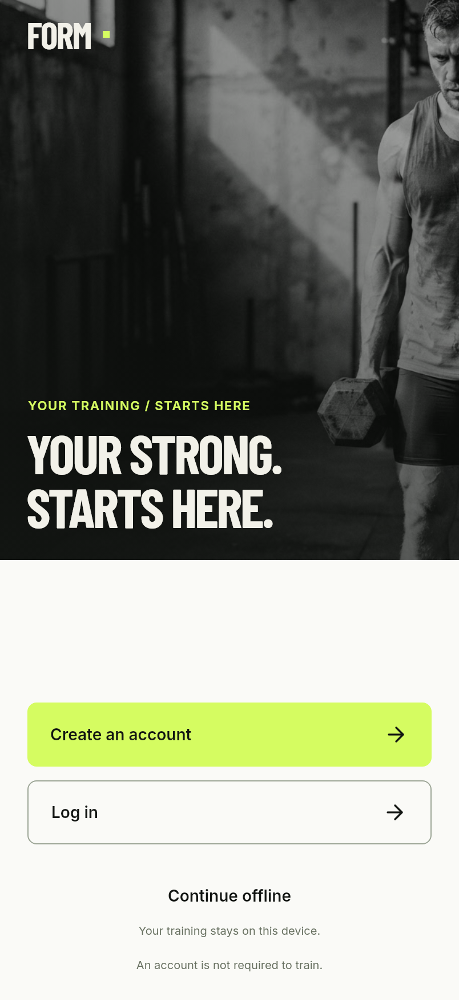<br><sub><b>Welcome</b> — three ways in, and the third one needs no account</sub></td>
<td width="33%">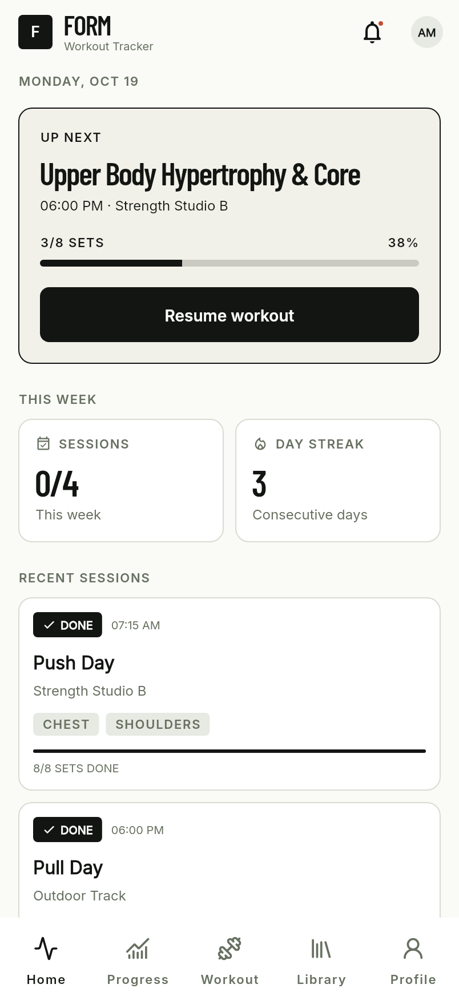<br><sub><b>Home</b> — today's session, the week, and what happened last</sub></td>
<td width="33%">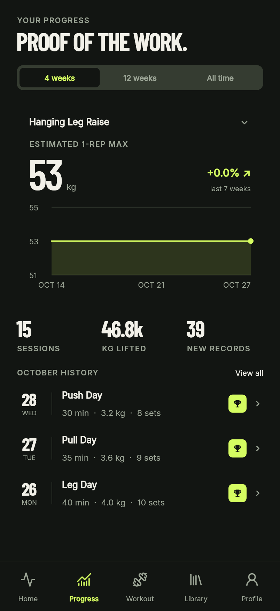<br><sub><b>Progress</b> — records, volume and consistency from the log</sub></td>
</tr>
<tr>
<td>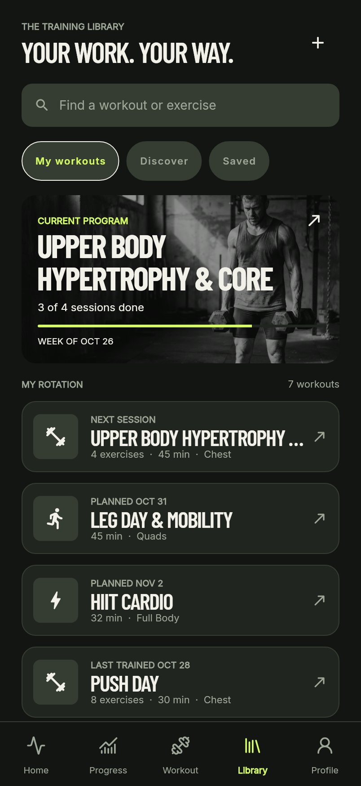<br><sub><b>Library</b> — your rotation, and a catalogue you can search</sub></td>
<td>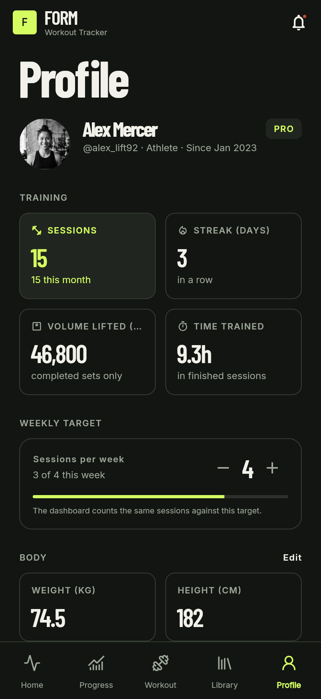<br><sub><b>Profile</b> — your week, your body metrics, your account</sub></td>
<td>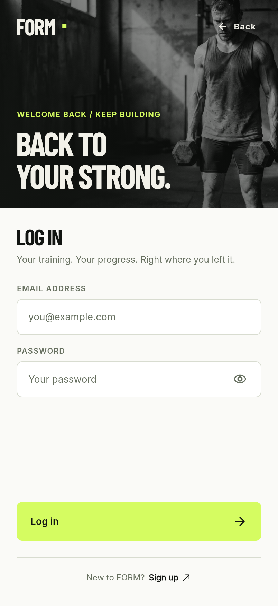<br><sub><b>Sign in</b> — and <a href="docs/screenshots/03-create-account.png">create account</a></sub></td>
</tr>
</table>

<table>
<tr>
<td width="33%">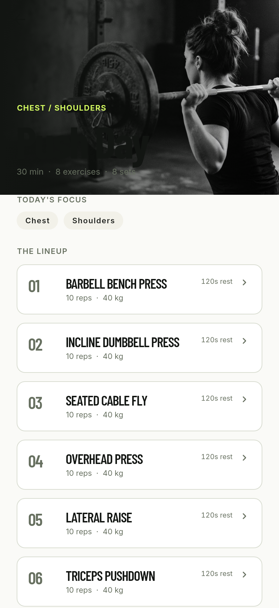<br><sub><b>Workout</b> — the plan, the sets and who owns the session</sub></td>
<td width="33%">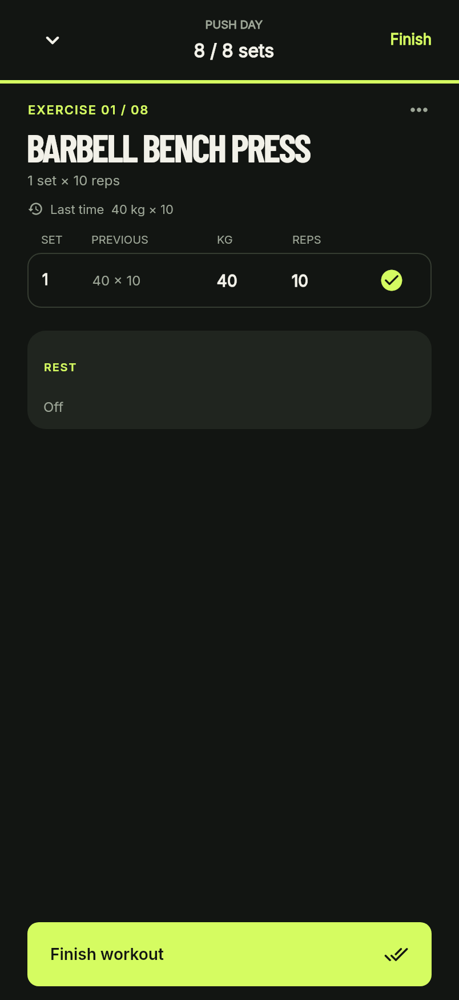<br><sub><b>Logging</b> — one set at a time, with last time's numbers beside it</sub></td>
<td width="33%">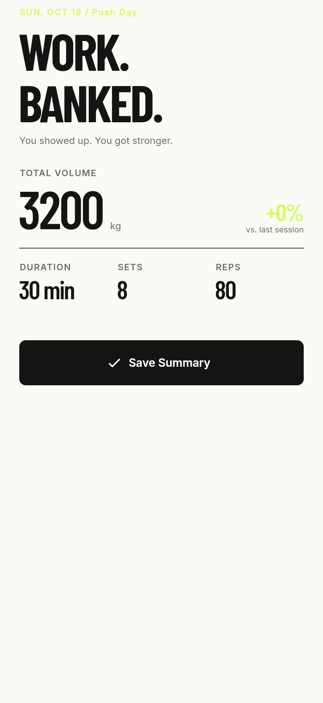<br><sub><b>Summary</b> — what the session was worth, and a record only if it beat one</sub></td>
</tr>
<tr>
<td>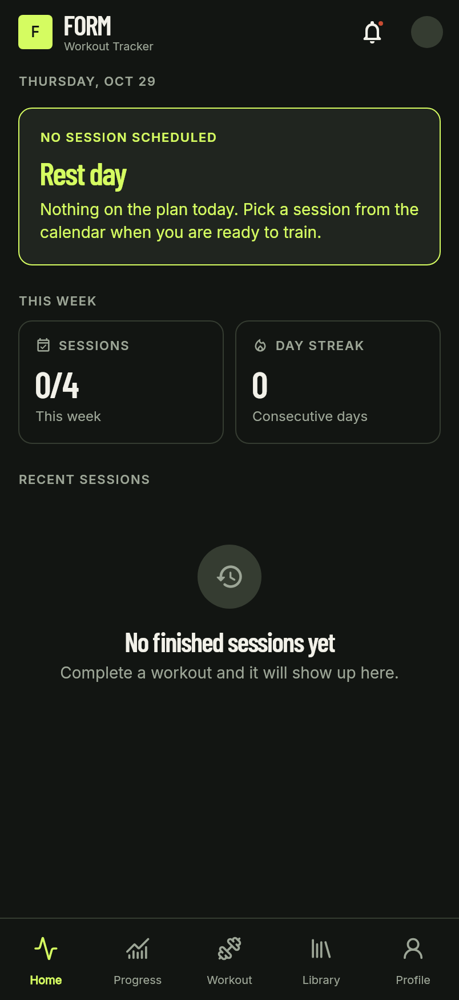<br><sub><b>Empty account</b> — what a fresh install actually shows</sub></td>
<td>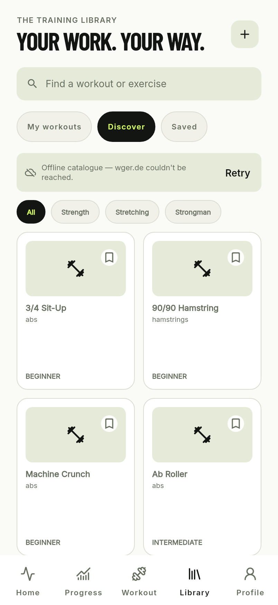<br><sub><b>Discover</b> — the wger catalogue, with the offline fallback called out</sub></td>
<td></td>
</tr>
</table>

The screenshots are the app's own widgets, rendered against a **sample account**
by `tool/screenshot_test.dart` and written to `docs/screenshots/`:

```bash
flutter test tool/screenshot_test.dart --update-goldens
```

It lives outside `test/` because it is a documentation tool, not an assertion: as
a test it would fail the suite every time the UI changed on purpose. FORM ships
with no training data — a fresh install opens on an empty account, and the empty
states are part of the design.

---

## Why FORM?

Tracking your lifts shouldn't feel like homework. Most apps either bury your
numbers under five layers of menus or lock them behind a subscription. FORM does
one thing and does it well: **it remembers what you lifted so you can see
yourself getting stronger.**

- **Log in seconds** — sets, reps and weight in a few taps, with the last set's
  numbers already in place.
- **Watch the line go up** — volume per week, compared against the week before.
- **Catch your PRs** — records ranked by estimated one-rep max, not by the
  biggest number on the bar.
- **Keep the streak** — consecutive days with a finished session.
- **Know what's next** — the week's plan, a rotation, and a catalogue to pull
  from.

No ads, no account required, and **your training never leaves the device** unless
you export it.

---

## What is actually implemented

| Area | Behaviour |
| --- | --- |
| **Logging** | Sessions hold exercises, each with sets of reps and weight. Ticking the last set finishes the session; unticking one reopens it. |
| **CRUD** | Create, rename, reschedule, edit and delete sessions; edit profile and body metrics; save and unsave exercises. Every write goes to SQLite and survives a restart. |
| **Accounts** | A local account with a PBKDF2-hashed password, or the device account with none. Each account owns its sessions, saved exercises and profile. See **[docs/AUTH.md](docs/AUTH.md)**. |
| **Catalogue** | `Discover` reads the wger REST API over `http`, shows loading, success and error states, and falls back to a bundled catalogue when the device is offline. |
| **Progress** | Records, volume with a week-on-week change, and a 30-day consistency figure - all derived from finished sessions, in one file. |
| **Empty states** | An empty account gets a first-session panel, not a scoreboard of zeros. |

Everything the app reports can be traced to a session in the database. There is
no placeholder content and no seeded training data in `lib/`.

---

## Accounts, briefly

FORM has no server. Sign-in is a **local account behind a seam that is shaped
like a server** - `AuthRepository` - so a real backend can replace the
implementation without the UI noticing. The verbs and their failure vocabulary
are checked against Supabase Auth's API: a sign-up can answer "signed in" or
"confirmation sent", and `unavailable` / `emailNotConfirmed` already exist as
refusals.

- **Continue offline** → the device account: no password, everything works.
- **Create account** → four steps in the design's order: name, age,
  measurements, then the credentials. Age is entered as a date of birth in
  day, month and year lists. Height and weight use FEET | CENTIMETERS and
  POUNDS | KILOGRAMS toggles; the chosen unit is saved and the profile keeps
  showing it. Both land in the athlete profile and stay editable there. The
  sign-up answers in
  the shape a verifying backend uses: signed in, or "check your inbox".
- **Change password** → from the account card in the profile, with the current
  password checked by the store.
- **Sign out** → back to the welcome screen; your data stays.
- **Delete account** → one confirmation, then the account's rows go.

Passwords are hashed with PBKDF2-HMAC-SHA256 (per-account salt, iteration count
stored in the verifier so it can be raised later) **off the UI isolate**, and the
UI never sees a hash. There are no credentials in the APK, no network call, and
no Firebase configuration file that a public repo would have to carry.
**[docs/AUTH.md](docs/AUTH.md)** explains the seam, the flow, the measurements
behind the iteration count, and what was deliberately left out.

---

## The network

The exercise catalogue comes from [wger.de](https://wger.de)'s public REST API
(`https://wger.de/api/v2/`) through `package:http`.

```
ExerciseApiClient  ──►  ExerciseCatalog  ──►  ExerciseLibrary.loadAll()
   (http, JSON)          (network-first,          (bundled fallback,
                          offline fallback)        parsed once)
```

- **Network-first**: a fresh catalogue is fetched, then shown.
- **Offline fallback**: on timeout, a socket error or an unparseable payload,
  the bundled catalogue is used and the UI says so. Failures collapse into one
  `ExerciseApiException`, so no screen deals in socket errors.
- **Loading / success / error / empty** states are all rendered, including the
  empty search result.

Attribution for the data is shown in the app and collected in
**[docs/ATTRIBUTION.md](docs/ATTRIBUTION.md)** (wger is CC BY-SA; the bundled
fallbacks are MIT and Unlicense).

---

## Tech stack

| Layer | Choice | Why |
| --- | --- | --- |
| Framework | Flutter 3.47 / Dart 3.13 | One codebase, first-class animation, good tooling. |
| State | `provider` 6.1 (`ChangeNotifier`) | Small enough to read in one sitting; no code generation. |
| Storage | `sqflite` 2.4 + `sqflite_common_ffi` + `path` | Real SQL: the app queries by day, by week and by exercise. The FFI factory makes the same store run on desktop, where the plugin has no implementation. |
| Network | `http` 1.6 | The assignment's requirement, and enough for one JSON API. |
| Crypto | `crypto` 3.0 | HMAC-SHA256 for PBKDF2, no platform channel required. |
| Dates | `intl` 0.20 | Weekday and month formatting without a locale bundle. |
| Type | `google_fonts` 9.0 | Inter + Barlow Condensed, **bundled** so nothing is fetched at runtime. |
| Equality | `equatable` 2.1 | Value equality on models, so `==` in tests means what it looks like. |
| Vectors | `flutter_svg` 2.3 | Lucide icons without shipping a bitmap per size. |
| Tests | `flutter_test`, `sqflite_common_ffi` | The real schema runs against a real SQLite file in tests, on the same factory. |
| Build tools | `flutter_launcher_icons`, `flutter_native_splash` | Icon and splash generated from checked-in artwork. |

---

## Architecture

```
lib/
├── main.dart                 # gate: splash → welcome/sign-in → app, routes
├── auth/                     # AuthRepository seam, local implementation, hasher
├── data/                     # AppDatabase (schema v8), repositories, session stats
├── models/                   # Workout, ExerciseLog, ExerciseSet, Profile, Account, Session
├── providers/                # AuthProvider, WorkoutProvider
├── screens/                  # welcome, sign in, sign-up steps, shell, home,
│                             # progress, workout, library, profile
├── theme/                    # colours, typography, motion tokens, page transitions
└── widgets/                  # nav bar, section header, cards, auth fields…
```

Motion is four decisions — a page, a sheet, a press and a state change — and it
lives in the theme rather than in the screens. **[docs/MOTION.md](docs/MOTION.md)**
lists the tokens, the four surfaces that answer a press, and what was left out.

Three rules the code keeps:

1. **Screens read state; providers write it.** A screen never touches the
   database.
2. **Writes go through one repository per account**, constructed with a
   `userId`; a row cannot be read or written without an owner.
3. **Derived numbers are derived.** Records, volume and streaks are computed from
   sessions on read, never stored, so they cannot go stale.

---

## Getting started

### Prerequisites

- [Flutter SDK](https://docs.flutter.dev/get-started/install) **3.47+** (Dart
  **3.13+**; both floors are declared in `pubspec.yaml`)
- Android SDK / a device or emulator

### Run it

```bash
git clone https://github.com/swcidd/form.git
cd form
flutter pub get
flutter run
```

### Check it

```bash
./tool/check.sh
```

That runs `dart format --output=none --set-exit-if-changed lib test tool`,
`flutter analyze` and `flutter test`, in that order, stopping at the first one
that fails. It is a script rather than a hosted workflow on purpose: it needs no
account, no runner and no network, so it behaves the same on a fresh clone and on
a machine that cannot reach a CI service.

One line makes git refuse a push that would land a red tree:

```bash
git config core.hooksPath .githooks
```

### Build a release APK

```bash
flutter build apk --release --split-per-abi
# build/app/outputs/flutter-apk/app-arm64-v8a-release.apk
```

Signing, the one-off `keytool` command and how to verify a build's signature are
in **[docs/BUILD.md](docs/BUILD.md)**. No signing secret is in this repository:
the keystore lives in a gitignored `android/key.properties`.

---

## How this was built

- **Pipeline**: `feat/<name>` → `dev` → `staging` → `master`. Promotion merges
  carry a message describing what the promotion delivers; the branch line goes in
  the body.
- **Commits**: [Conventional Commits](https://www.conventionalcommits.org/), one
  concern each, and **every commit is green on its own** - `dart format`,
  `flutter analyze` and the full suite were run before each one.
- **Review**: every PR got inline review comments on the lines that carried a
  decision (identity, schema, lifecycle), not a rubber stamp, and was merged only
  with the suite green on the merged tree.
- **Tests**: 328 widget, provider and database tests. The dangerous parts are
  covered directly: the v3 → v8 migration builds an old database by hand, the
  v5 → v8, v6 → v8 and v7 → v8 migrations leave the date of birth unset and the
  units metric, signing in as somebody else asserts the old store is disposed,
  and the counting rules have their own tests.

---

## Debugging

Two DevTools cases are written up in **[docs/DEVTOOLS.md](docs/DEVTOOLS.md)**: the
release APK's size budget, read from the App Size tool, and the frame that a
password hash blocked, found in the Performance view and moved off the UI
isolate.

Golden tests are the other half of the debugging story: `flutter test
--update-goldens` renders the real screens, and the weekly-goal disagreement
(`4/4` on the dashboard, `0 of 4` in the library) was found by looking at two
screenshots side by side rather than by reading either screen's code.

---

## Course requirements

| Requirement | Where |
| --- | --- |
| REST API over `http`, JSON, loading/success/error | `lib/exercise_library.dart` + `Discover` |
| 4+ screens | 13: welcome, sign in, sign-up name, sign-up age, sign-up account, home, progress, workout, library, profile, workout detail, set logger, summary |
| 3+ reusable widgets | `AuthField`, `AuthAction`, `AppNavBar`, `WorkoutCard`, `SectionHeader`, `EmptyState`… |
| Provider state management | `AuthProvider`, `WorkoutProvider` |
| CRUD | Sessions, exercises, sets, profile, saved exercises |
| Empty / offline / failed API / validation | Empty account panel, bundled catalogue fallback, banners, field errors |
| Public repository with PRs and review comments | [github.com/swcidd/form](https://github.com/swcidd/form/pulls) |
| Icon, splash, app name, release APK | `assets/branding/`, `flutter_launcher_icons`, `flutter_native_splash`, `docs/BUILD.md` |
| Documentation | README, [AUTH](docs/AUTH.md), [BUILD](docs/BUILD.md), [DEVTOOLS](docs/DEVTOOLS.md), [MOTION](docs/MOTION.md), [ATTRIBUTION](docs/ATTRIBUTION.md) |

---

## Team

| Member | Role |
| --- | --- |
| **Sherwin Sid S. Sañol** ([@swcidd](https://github.com/swcidd)) | Design mapping (Figma), Flutter UI, state management, data layer and schema, auth, tests, Git pipeline, documentation |

Built for **SE2142 — Software Engineering Tools and Practices**.

---

## Data sources and licences

FORM does not invent its exercise catalogue — it reads the live data from
wger.de and ships one canonical offline catalogue generated from two open data
sets. The licences that ask for attribution get one on screen and in
**[docs/ATTRIBUTION.md](docs/ATTRIBUTION.md)**, which also carries the notice
texts and the two font licences.

| Source | Licence |
| --- | --- |
| [wger.de](https://wger.de) REST API — the live catalogue | CC BY-SA 3.0/4.0, per entry |
| [exercemus/exercises](https://github.com/exercemus/exercises) — source for the bundled catalogue | MIT, © 2022 exercemus |
| [free-exercise-db](https://github.com/yuhonas/free-exercise-db) — source for the bundled catalogue | The Unlicense (public domain) |

The app ships one file, `assets/data/exercises.json`, built by
`tool/build_exercises.dart`. The raw upstream downloads live in
`tool/exercise_sources/` so the catalogue can be rebuilt and audited without
shipping either source in the APK. Catalogue cards hotlink a small Unsplash set
for their thumbnails for now, with no API key; see
**[docs/ATTRIBUTION.md](docs/ATTRIBUTION.md)**.

The interface icons are [Lucide](https://lucide.dev) (ISC). Inter and Barlow
Condensed are bundled with the app under the SIL Open Font License 1.1, so no
font is fetched at runtime.

AI assistance is disclosed in the report and in each commit's own words; the
design decisions, measurements and tests are the author's.

---

## Deliberately not here

A calendar year view, social features and cloud sync were cut on purpose, not
forgotten: they would have added surfaces with nothing behind them. Vitals,
calories and step counts are absent for the same reason — FORM counts training,
and nothing else. `docs/AUTH.md` lists the same kind of decisions for accounts.

---

## License

This project is licensed under the MIT License — see [LICENSE](LICENSE) for details.
